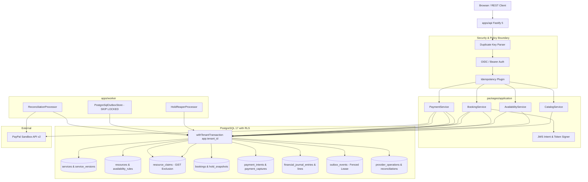

# velvetAI

> **velvetAI — AI agents can book your appointments, but only you can approve and pay.**
>
> **Live Demo:** https://velvetai-five.vercel.app

velvetAI is a production-grade appointment booking and deposit platform for local service businesses. AI agents (in-page Ask AI and stateless MCP clients) can search services, inspect availability, and place temporary slot holds—while every booking requires explicit human approval and PayPal Sandbox payment finality enforced by PostgreSQL 17 and deterministic Abuse Lab checks.

## Try It

1. **Sign in** at [https://velvetai-five.vercel.app](https://velvetai-five.vercel.app).
2. Open **Ask AI** and ask: `"Find an Executive Haircut tomorrow afternoon"`.
3. **Click a time** from the available slots returned.
4. Click **Hold this time** to reserve the slot and generate an ES256-signed booking intent.
5. Click **Open approval page** to review the exact service, time, deposit, and cancellation policy.
6. Approve the terms and **pay the deposit with the PayPal Sandbox buyer** account.

## Built With

- **Payments:** PayPal Orders v2 + PayPal JS SDK v6 + Webhooks
- **AI & Agent Protocol:** Google Gemini via Vercel AI SDK, Model Context Protocol (MCP)
- **Authentication:** Auth0 (OIDC + JWT RBAC + JIT provisioning)
- **Frontend:** React 19, Vite, TypeScript — hosted on **Vercel**
- **Backend:** Fastify 5, Node.js 24 LTS, TypeScript — hosted on **Render**
- **Database:** PostgreSQL 17 with GiST exclusion constraints + Row-Level Security (`FORCE ROW LEVEL SECURITY`)
- **Scheduling UI:** Bryntum Scheduler 7.3.8 (trial)

## Future Work

- **Forecasting UI:** Demand-forecast calendar overlays, variable deposit signals, and weak-slot promotions.
- **Judge reset UI:** Browser console for one-click judge-tenant resets, guided checklist, and booking proof drawer.
- **Fault-injection demo:** Simulated dropped PayPal capture reply toggle demonstrating live webhook and outbox reconciliation.

---

## Architecture Overview

velvetAI is built as a TypeScript modular monolith in a pnpm/Turborepo workspace:

### Architecture Diagram



### Applications (`apps/`)

- **`apps/api`**: Fastify 5 REST API, RFC 9457 Problem Details, OpenAPI generation, mutation idempotency, tenant context.
- **`apps/web`**: React 19, Vite, lightweight custom context-based router (History API), booking and schedule interfaces.
- **`apps/worker`**: Background worker for PostgreSQL transactional outbox dispatching (`FOR UPDATE SKIP LOCKED`, fenced leases), hold reaping, and PayPal provider reconciliation.
- **`apps/abuse-lab`**: Automated security validation suite executing 20+ deterministic attack scenarios.

### Packages (`packages/`)

- **`packages/contracts`**: Shared Zod schemas, branded primitive types (UUIDv7, MoneyMinor, IanaTimeZone, CurrencyCode), Problem Details schemas.
- **`packages/domain`**: Pure domain entities, value objects, invariants, and domain error classes (zero external framework dependencies).
- **`packages/application`**: Hexagonal ports, real PostgreSQL catalog and availability services, and command/query handlers.
- **`packages/db`**: PostgreSQL 17 migrations, Kysely SQL query client, tenant isolation utilities (25 RLS tables).
- **`packages/tool-registry`**: Shared tool definitions and execution registry for REST, MCP, WebMCP, and Ask AI.
- **`packages/integrations-paypal`**: Typed PayPal REST adapters (Orders v2, Payments v2, Invoicing v2, Webhooks v1).
- **`packages/forecasting`**: Baseline statistical models (no-show, slot-fill, cash forecast) with Brier and WAPE metrics.
- **`packages/observability`**: Structured Pino logging with mandatory secret/PII redaction and Zod environment validation.

---

## Prerequisites

- **Node.js**: Node 24 LTS (pinned via `mise.toml` to `24.22.1`, activated via `mise`)
- **pnpm**: `12.14.0` (pinned via `mise.toml` and root `packageManager`)
- **PostgreSQL 17**: Local Homebrew PostgreSQL 17 (`brew services postgresql@17` on port 5432 with `max_connections 400`)
- **Docker & Docker Compose**: For local Redis 7 (`docker compose up -d redis`). The `postgres` service in `docker-compose.yml` is optional and must not run simultaneously with Homebrew PostgreSQL.

---

## Local Setup (PowerShell & CI Compatible)

### 1. Clone & Enter Directory

```powershell
git clone <repo-url> velvetAI
cd velvetAI
```

### 2. Configure Environment

Copy the `.env.example` file to `.env`:

```powershell
Copy-Item .env.example .env
```

_(On Linux/macOS: `cp .env.example .env`)_

### 3. Start Local Redis & Verify PostgreSQL

Ensure Homebrew PostgreSQL 17 is running on port 5432, then start Redis:

```bash
docker compose up -d redis
```

_(Note: `pnpm docker:up` starts Docker services. If using Homebrew PostgreSQL, do not start the Docker postgres container to prevent port 5432 collision)._

### 4. Install Dependencies

```powershell
pnpm install
```

### 5. Prepare Test Databases

```bash
# Prepares and migrates all isolated test databases (see docs/testing.md)
pnpm db:test:prepare
```

### 6. Run Verification Checks

```powershell
# Typecheck all packages and apps (strict TypeScript)
pnpm typecheck

# Lint all code (ESLint 9 flat config, zero warnings)
pnpm lint

# Run all unit, property, and integration tests across monorepo
pnpm test

# Run PostgreSQL 17 concurrency, RLS isolation, and hold reaper tests directly
pnpm --filter @velvetai/db test
pnpm --filter @velvetai/application test
pnpm --filter @velvetai/worker test
pnpm --filter @velvetai/abuse-lab test

# Build all packages and applications
pnpm build
```

### 6. Start Development Servers

```powershell
pnpm dev
```

---

## Security Invariants

1. **Multi-Tenancy & RLS**: Tenant identity is always derived from authenticated membership tokens; `tenant_id` is never accepted from client bodies or query parameters. All 25 tenant tables enforce `FORCE ROW LEVEL SECURITY`. Queries execute strictly within `withTenantTransaction` using `set_config('app.tenant_id', ..., true)`, guaranteeing zero connection pool context leakage.
2. **Concurrency Safety**: Resource slot holds are protected against double bookings using PostgreSQL GiST exclusion constraints on `(tenant_id, resource_id, blocked_during) WHERE (blocking)`. Overlap checks evaluate persisted blocking state, never wall-clock functions.
3. **Dual Trust Claims**: Booking intent integrity is cryptographically sealed via ES256 IEEE-P1363 JWS with strict header validation (`typ: velvetai-intent+jwt`, `alg: ES256`, explicit `kid`). Buyer approval is captured separately through a single-use opaque confirmation token via an interactive approval locator. Commit requires both artifacts.
4. **Financial Integrity**: Money is stored strictly as integer minor units (`bigint`); floating-point money is prohibited.
5. **Idempotency**: All mutating operations support `Idempotency-Key` with canonical payload hashing and 409 conflict detection on hash mismatch.
6. **Durable Events**: Domain mutations and outbox events commit together in one atomic database transaction. Zero network calls occur inside commit transactions.
7. **Redaction**: Access tokens, PayPal secrets, customer notes, and direct PII are censored from application logs.

---

## License

This project is licensed under the MIT License - see the [LICENSE](LICENSE) file for details.
